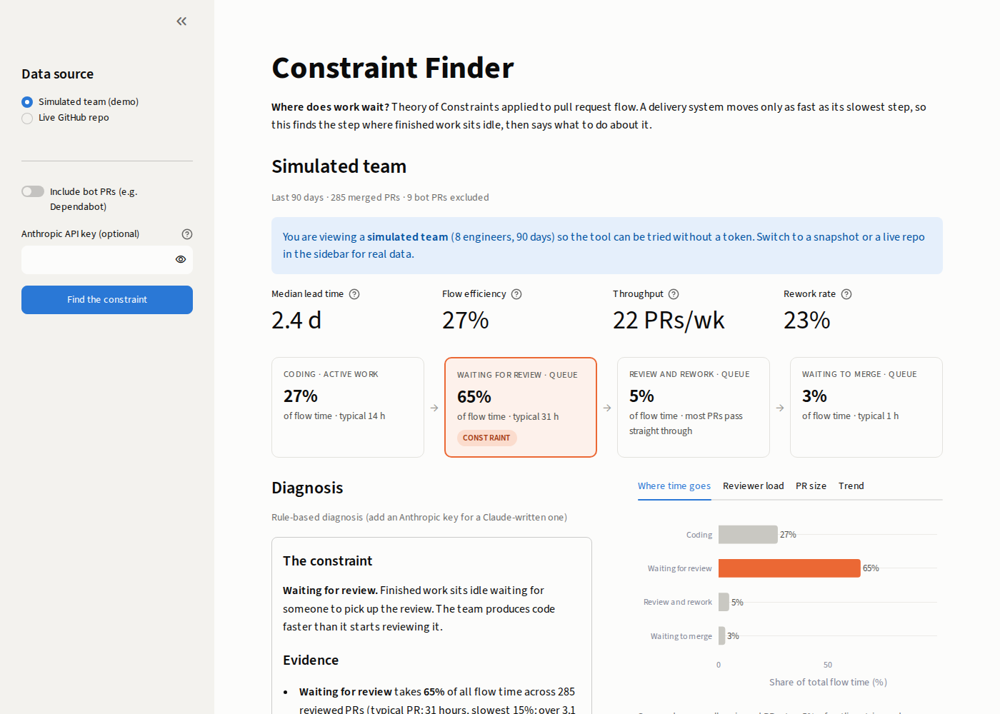

# Constraint Finder

**Where does work wait?** Theory of Constraints applied to pull request flow.



A delivery system moves only as fast as its slowest step. Teams adopting AI coding agents often expect to ship faster and don't, because writing code was never the slowest step. Constraint Finder reads a repository's merged pull requests, measures where finished work sits idle, names the constraint, and recommends what to do using the five focusing steps.

## What it measures

Every merged PR is split into four stages:

| Stage | From | To | Kind |
|---|---|---|---|
| Coding | first commit | PR ready for review | active work |
| Waiting for review | ready for review | first human review | queue |
| Review and rework | first review | final approval | queue |
| Waiting to merge | final approval | merged | queue |

- **Constraint:** the stage holding the largest share of total flow time across all reviewed PRs (top 5% of each stage trimmed so one stale PR can't decide it).
- **Flow efficiency:** coding time divided by lead time. Most teams land well under 50%.
- **Supporting signals:** reviewer concentration, PR size vs wait, rework rate, weekly trend.
- Bot PRs (Dependabot, Renovate) and bot reviews are excluded. Self-reviews don't count. Drafts enter the queue when marked ready.

## How the AI is used

All numbers are computed in Python (`cf/metrics.py`). Claude receives only those numbers and writes the diagnosis; its prompt forbids inventing or recomputing figures. Without an API key, a rule-based writer produces the same report structure, so the tool always works.

```
GitHub GraphQL  ->  normalize  ->  flow metrics  ->  constraint  ->  Claude (explains)  ->  dashboard
                    (github_client)  (metrics)                        (diagnosis)          (app.py)
```

## Run it

```bash
pip install -r requirements.txt
streamlit run app.py
```

Opens with a simulated team so it works with no credentials. For a real repository, choose **Live GitHub repo** in the sidebar and paste a read-only GitHub token ([create one](https://github.com/settings/tokens), no scopes needed for public repos).

Command line, with an optional snapshot the dashboard can load offline:

```bash
export GITHUB_TOKEN=...
export ANTHROPIC_API_KEY=...   # optional
python cli.py JasperFx/wolverine --days 90 --save
```

## Deploy (Streamlit Community Cloud, free)

1. Push this folder to a public GitHub repo.
2. At [share.streamlit.io](https://share.streamlit.io), create an app pointing at `app.py`.
3. Under **Secrets**, add `GITHUB_TOKEN` and (optionally) `ANTHROPIC_API_KEY`.

## Project layout

```
app.py              Streamlit dashboard
cli.py              command line + snapshot capture
cf/github_client.py GraphQL fetch and normalization
cf/metrics.py       stage durations, constraint, signals
cf/diagnosis.py     Claude report + rule-based fallback
cf/demo.py          simulated team for the demo mode
cf/snapshot.py      save/load analyses
tests/              pytest suite, including a dashboard render test
```

## Limits and next steps

- Durations are calendar hours, so nights and weekends count as waiting (as the work item experiences them). A business-hours mode is a small change.
- Only merged PRs are measured. Adding open PRs would show current work in progress, the queue itself.
- Natural extensions: compare before and after an AI tool rollout, multi-repo views for a platform org, and a Slack digest when the constraint moves.
